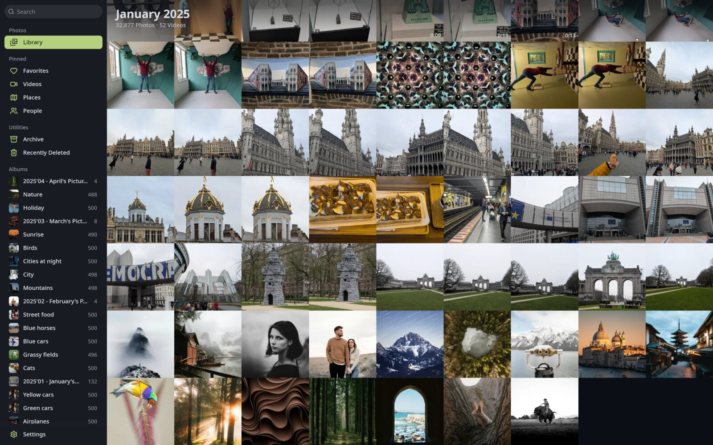
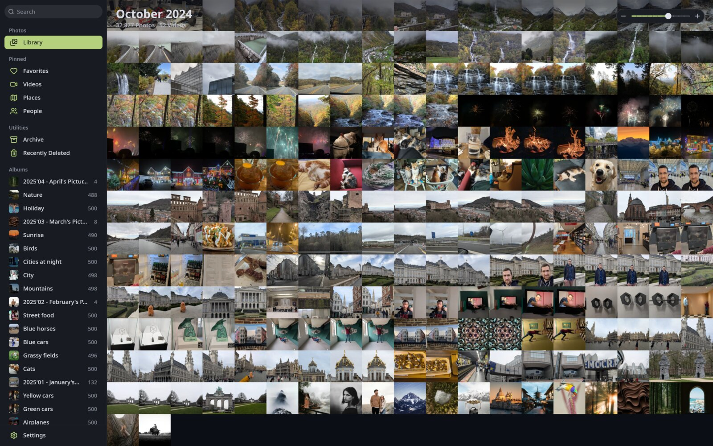
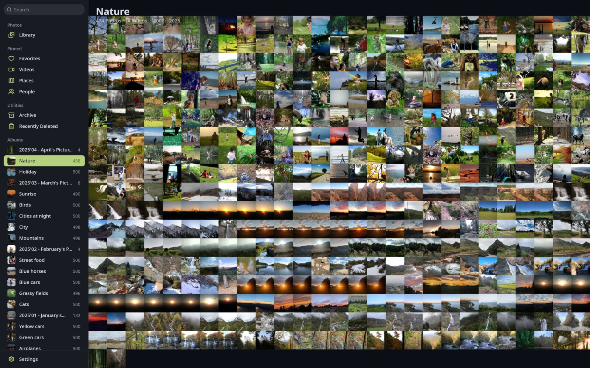
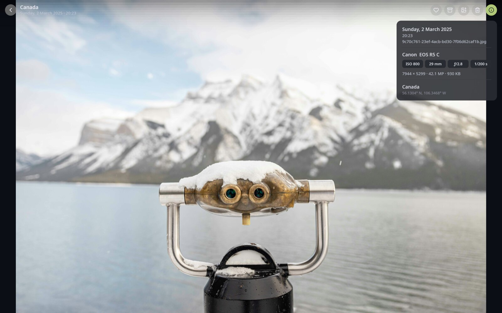
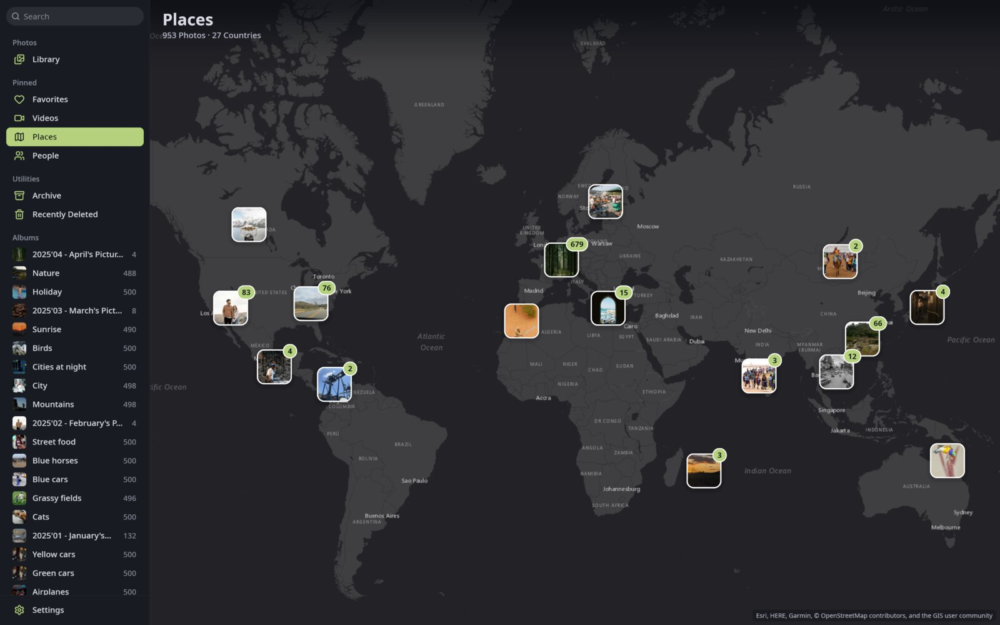
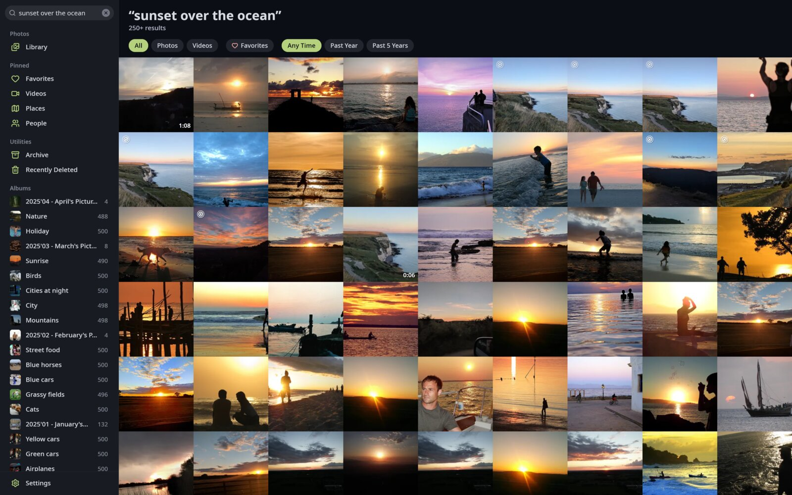
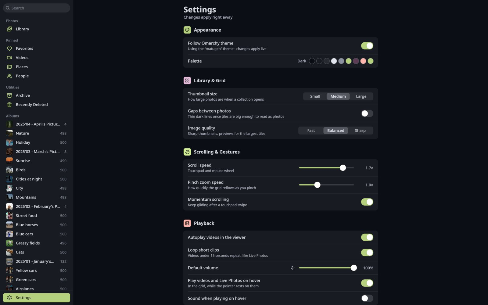
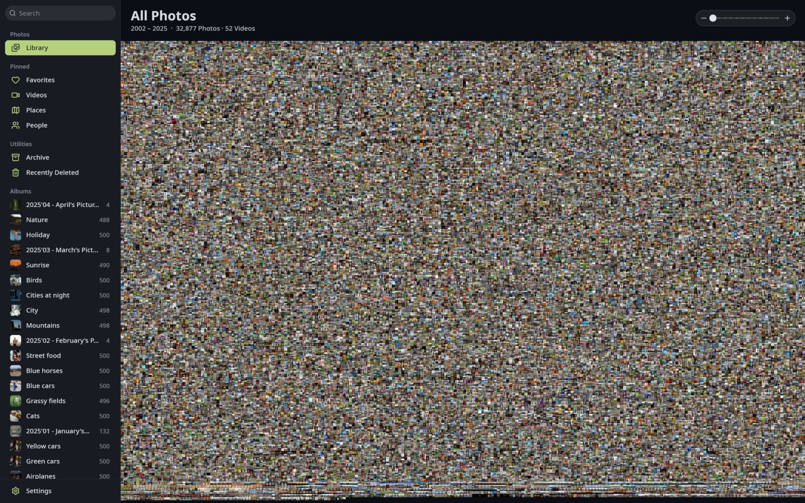

<p align="center">
  
</p>

<h1 align="center">Lumen</h1>

<p align="center">
  A fast, native desktop photo viewer for your <a href="https://immich.app">Immich</a> library.<br>
  Written in Rust, drawn on the GPU, built for Linux.
</p>



Lumen is a desktop client for a self-hosted Immich server. It shows your whole library as one
smooth, zoomable timeline and opens photos and videos instantly. It's
built for big libraries: tens of thousands of photos scroll and zoom at full frame rate, and
everything you've seen once is kept on disk, so the app opens straight into your library.

## Features

- **One continuous timeline.** Pinch, scroll or use the zoom slider to go from a few large
  photos to your entire library on one screen. Zoom animates smoothly between levels.
- **Instant thumbnails.** Thumbnails are downloaded in the background and cached on disk, so
  browsing works offline and never shows the same placeholders twice.
- **Viewer** with zoom, swipe between photos, an info panel (date, camera, lens, exposure,
  location), video playback via GStreamer (hardware decoding when available) and Live Photos.
- **Albums, Favorites, Videos, Archive and Recently Deleted**, plus People and Places.
- **Places:** your photos clustered on a world map.
- **Smart search** using Immich's CLIP search ("sunset over the ocean"), with filters for type,
  favorites and date.
- **Organize:** favorite, archive, add to album and move to trash, with undo. Lumen never
  deletes anything permanently.
- **Live updates:** changes made on your phone or the web show up right away.
- **Home and away:** set a local address (e.g. your LAN IP) and an optional remote one.
  Lumen uses the local address when it answers and falls back to the remote one when you're
  away.
- **Fast sync:** after the first load, only the months that changed are fetched again.
- **Theming:** a dark palette by default, or follow your [Omarchy](https://omarchy.org) theme, light or dark, live.

| | |
|---|---|
|  |  |
|  |  |
|  |  |

<details>
<summary>The whole library on one screen (32,877 photos)</summary>



</details>

<sub>Screenshots use the public <a href="https://demo.immich.app">Immich demo</a> library.</sub>

## Installing

Lumen currently targets **Linux (Wayland)**. It needs a GPU with Vulkan support.

### Dependencies

- Rust (stable, edition 2024): [rustup.rs](https://rustup.rs)
- GStreamer 1.x with the base, good, bad and libav plugins, for video playback
- Wayland client libraries

Arch Linux:

```sh
sudo pacman -S --needed rust gstreamer gst-plugins-base gst-plugins-good gst-plugins-bad gst-libav wayland
```

Debian / Ubuntu:

```sh
sudo apt install libgstreamer1.0-dev libgstreamer-plugins-base1.0-dev \
  gstreamer1.0-plugins-good gstreamer1.0-plugins-bad gstreamer1.0-libav libwayland-dev
```

### Build

```sh
git clone https://github.com/lucianosrp/lumen
cd lumen
cargo build --release
./target/release/lumen
```

To add it to your app launcher:

```sh
install -Dm755 target/release/lumen ~/.local/bin/lumen
install -Dm644 assets/lumen.svg ~/.local/share/icons/hicolor/scalable/apps/lumen.svg
install -Dm644 assets/lumen.desktop ~/.local/share/applications/lumen.desktop
```

## Signing in

1. In Immich, go to **Account Settings › API Keys** and create a key.
2. Start Lumen, enter your server's address and paste the key. Lumen checks the key and signs
   you in straight away.

Your addresses and key are stored in `~/.config/lumen/config.json`, readable only by you. You
can also set them with the `IMMICH_URL`, `IMMICH_FALLBACK_URL` and `IMMICH_API_KEY`
environment variables. Caches live in `~/.cache/lumen/`, and their size limit can be changed
in Settings › Storage.

To try Lumen without a server, run `lumen --demo` for a generated library.

## Keyboard shortcuts

| Key | Grid | Viewer |
|---|---|---|
| `+` / `-` / `0` | Zoom in / out / reset | Zoom in / out / fit |
| Arrows, Page Up/Down, Space | Scroll | Previous / next photo (seek in videos) |
| Home / End | Jump to newest / oldest | |
| Enter / Space | | Play video |
| `i` | | Show info |
| `l` | | Play Live Photo |
| `m` | Open Places | Mute |
| `.` | Favorite selection | Favorite |
| `a` | Add selection to album | Add to album |
| Delete | Move selection to Recently Deleted | Move to Recently Deleted |
| Ctrl+L | Archive / unarchive | Archive / unarchive |
| Ctrl+A / Esc | Select all / clear selection | Close |
| Ctrl+Z | Undo | Undo |
| `f` / F11 | Fullscreen | Fullscreen |
| Ctrl+B | Toggle sidebar | |
| Ctrl+, | Settings | |
| Ctrl+Q | Quit | Quit |

## Status

Lumen is a personal project, young and under active development. It's read-mostly: it only
writes to your server when you favorite, archive, add to an album or move something to the
trash, and it never deletes permanently. Bug reports and ideas are welcome.

Lumen is an independent project and isn't affiliated with Immich.

## Credits

- [Immich](https://immich.app) for the server and API
- Icons from [Lucide](https://lucide.dev) (ISC, see `assets/icons/LICENSE`)
- Map tiles: Esri, HERE, Garmin, © OpenStreetMap contributors and the GIS user community
- Built with [wgpu](https://wgpu.rs), [winit](https://github.com/rust-windowing/winit),
  [glyphon](https://github.com/grovesNL/glyphon) and [GStreamer](https://gstreamer.freedesktop.org)

## License

[MIT](LICENSE)
